# DevSecOps Portfolio — Narjess Dabbech

## I. Mise en place initiale

### 1. Installation Ubuntu Server et configuration SSH sécurisé

**Système :** Ubuntu Server 22.04.5 LTS (VM VirtualBox)

**Installation du serveur SSH :**
```bash
sudo apt update
sudo apt install openssh-server -y
sudo systemctl enable ssh
sudo systemctl start ssh
```

**Vérification du service :**
```bash
sudo systemctl status ssh
```
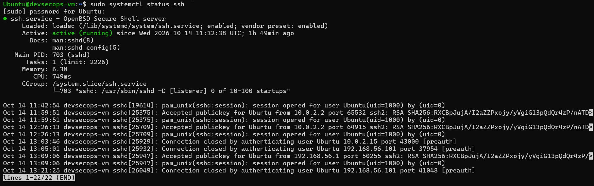

**Configuration sécurisée** — fichier `/etc/ssh/sshd_config.d/99-hardening.conf` :
```
PasswordAuthentication no
PermitRootLogin no
PubkeyAuthentication yes
```
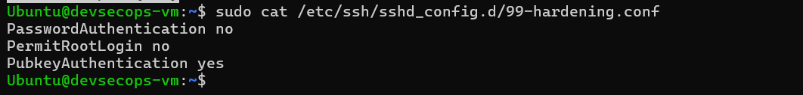

---

### 2. Test SSH depuis la machine physique

**Configuration réseau VirtualBox :**
- Adaptateur 1 : NAT (accès Internet)
- Adaptateur 2 : Réseau privé hôte — IP VM : `192.168.56.101`

**Depuis le PC physique (Windows PowerShell) :**
```powershell
PS C:\Users\DELL> ssh Ubuntu@192.168.56.101
Welcome to Ubuntu 22.04.5 LTS (GNU/Linux 5.15.0-176-generic x86_64)
...
Ubuntu@devsecops-vm:~$
```
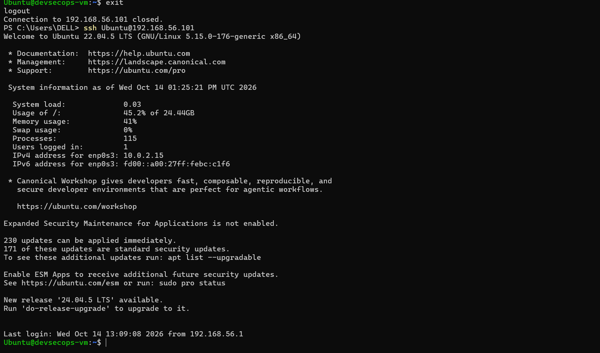

**Preuve d'authentification par clé publique (logs côté VM) :**
```bash
sudo journalctl -u ssh --since "2 hours ago" | grep "Accepted publickey"
```
```
Accepted publickey for Ubuntu from 10.0.2.2 port 58499 ssh2: RSA SHA256:RXCBpJujA/I2...
```
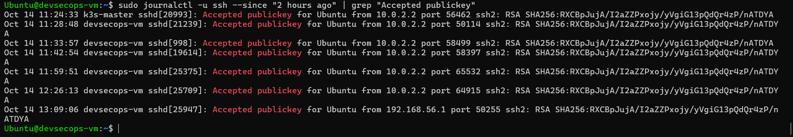

---

### 3. Installation de Docker

**Installation via le dépôt officiel Docker :**
```bash
sudo apt update
sudo apt install -y ca-certificates curl gnupg lsb-release

sudo mkdir -p /etc/apt/keyrings
curl -fsSL https://download.docker.com/linux/ubuntu/gpg | \
  sudo gpg --dearmor -o /etc/apt/keyrings/docker.gpg

echo "deb [arch=$(dpkg --print-architecture) signed-by=/etc/apt/keyrings/docker.gpg] \
  https://download.docker.com/linux/ubuntu $(lsb_release -cs) stable" | \
  sudo tee /etc/apt/sources.list.d/docker.list > /dev/null

sudo apt update
sudo apt install -y docker-ce docker-ce-cli containerd.io \
  docker-buildx-plugin docker-compose-plugin

sudo usermod -aG docker $USER
```

**Vérification de la version :**
```bash
docker --version
```
```
Docker version 29.9.0, build f415da8
```

**Statut du service Docker :**
```bash
sudo systemctl status docker
```
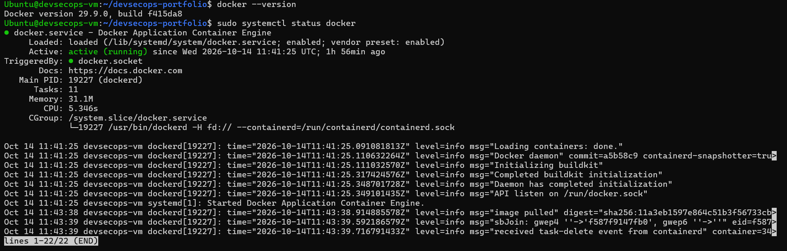

**Test avec l'image hello-world :**
```bash
docker run hello-world
```
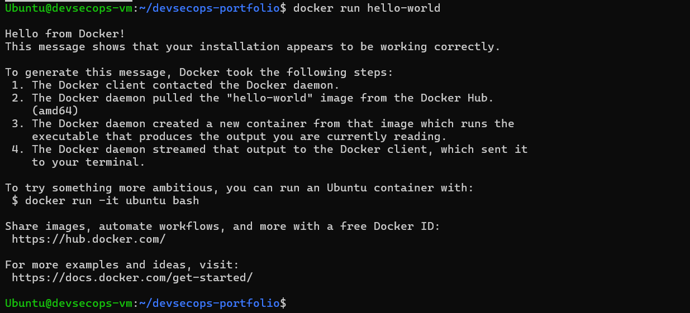

---

### 4. Installation de Jenkins

**Installation de Java 17 (prérequis) :**
```bash
sudo apt install -y fontconfig openjdk-17-jre
```

**Ajout de la clé et du dépôt Jenkins :**
```bash
sudo wget -O /usr/share/keyrings/jenkins-keyring.asc \
  https://pkg.jenkins.io/debian-stable/jenkins.io-2023.key

echo "deb [signed-by=/usr/share/keyrings/jenkins-keyring.asc] \
  https://pkg.jenkins.io/debian-stable binary/" | \
  sudo tee /etc/apt/sources.list.d/jenkins.list > /dev/null
```

**Installation de Jenkins :**
```bash
sudo apt update
sudo apt install -y jenkins
```

**Vérification du service :**
```bash
sudo systemctl status jenkins
```
```
● jenkins.service - Jenkins Continuous Integration Server
     Active: active (running)
             └─ /usr/bin/java -jar /usr/share/java/jenkins.war --httpPort=8080
```
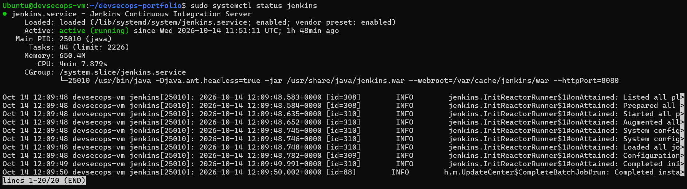

**Accès à l'interface web depuis la machine physique :**

Jenkins écoute sur le port 8080. Depuis le PC Windows, accès via l'IP host-only de la VM :

👉 **http://192.168.56.101:8080**

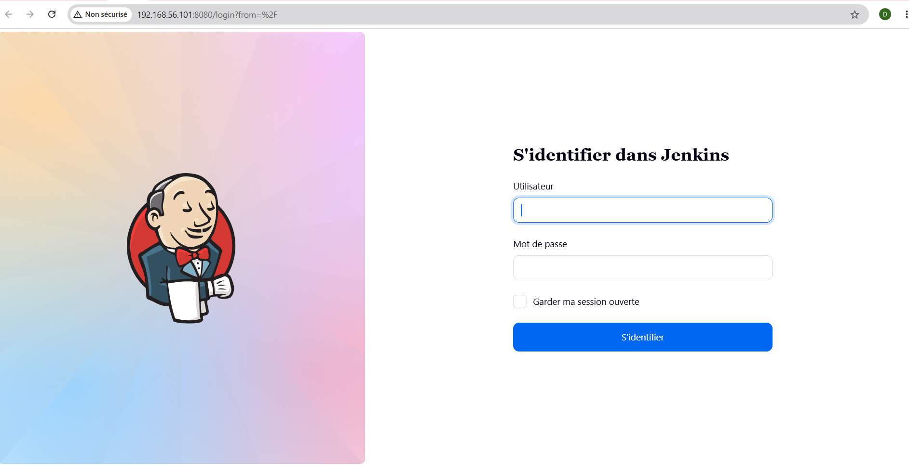

---

### 5. Mini CV One Page (HTML5 / CSS3 / JavaScript)

**Création du projet :**
```bash
mkdir -p ~/devsecops-portfolio
cd ~/devsecops-portfolio
# Création de index.html, style.css, script.js
```

**Initialisation Git et publication :**
```bash
git init
git add .
git commit -m "Initial commit: mini CV"
git remote add origin git@github.com:Narjess805/minicv.git
git push -u origin main
```

**Lien du dépôt GitHub :** https://github.com/Narjess805/minicv

**Aperçu du CV :**
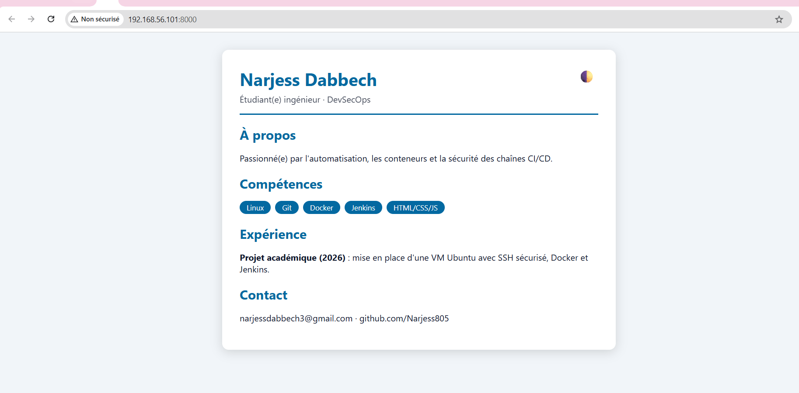

---

### 6. Activer les push GitHub via SSH

**Génération de la clé SSH locale :**
```bash
ssh-keygen -t ed25519 -C "vm-github"
cat ~/.ssh/id_ed25519.pub
```
```
ssh-ed25519 AAAAC3NzaC1lZDI1NTE5AAAAINJVHF8ddz9Vgtm877qkioC6meymFaOwpKiiRQbfnepl vm-github
```

**Ajout de la clé sur GitHub :**
- GitHub → Settings → SSH and GPG keys → New SSH key
- Title : `devsecops-vm`
- Key type : `Authentication Key`
- Coller la clé publique → Add SSH key

**Test de la connexion :**
```bash
ssh -T git@github.com
```
```
Hi Narjess805! You've successfully authenticated, but GitHub does not provide shell access.
```

**Configuration du dépôt en SSH :**
```bash
git remote set-url origin git@github.com:Narjess805/minicv.git
git remote -v
```
```
origin  git@github.com:Narjess805/minicv.git (fetch)
origin  git@github.com:Narjess805/minicv.git (push)
```

**Push réussi :**
```bash
git push -u origin main
```
```
 * [new branch]      main -> main
Branch 'main' set up to track remote branch 'main' from 'origin'.
```

---

## III. Dockerisation initiale

### 10. Création du Dockerfile

**Fichier `Dockerfile` :**
```dockerfile
FROM nginx:alpine

COPY index.html /usr/share/nginx/html/
COPY style.css /usr/share/nginx/html/
COPY script.js /usr/share/nginx/html/

EXPOSE 80
CMD ["nginx", "-g", "daemon off;"]
```

**Explication :**
- `FROM nginx:alpine` : image de base légère (~20 Mo)
- `COPY ...` : copie les 3 fichiers du portfolio dans Nginx
- `EXPOSE 80` : documente le port exposé
- `CMD` : lance Nginx au premier plan

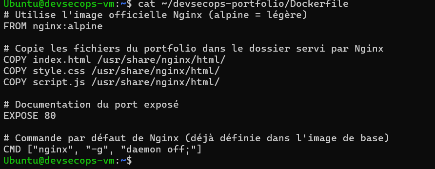

---

### 11. Construction de l'image `cv-docker`

**Commande :**
```bash
docker build -t cv-docker .
```

**Résultat :**
```
[+] Building 47.0s (9/9) FINISHED
 => naming to docker.io/library/cv-docker:latest
```

**Vérification :**
```bash
docker images | grep cv-docker
```
```
cv-docker:latest   09700eeedad8   93.6MB   26.3MB
```

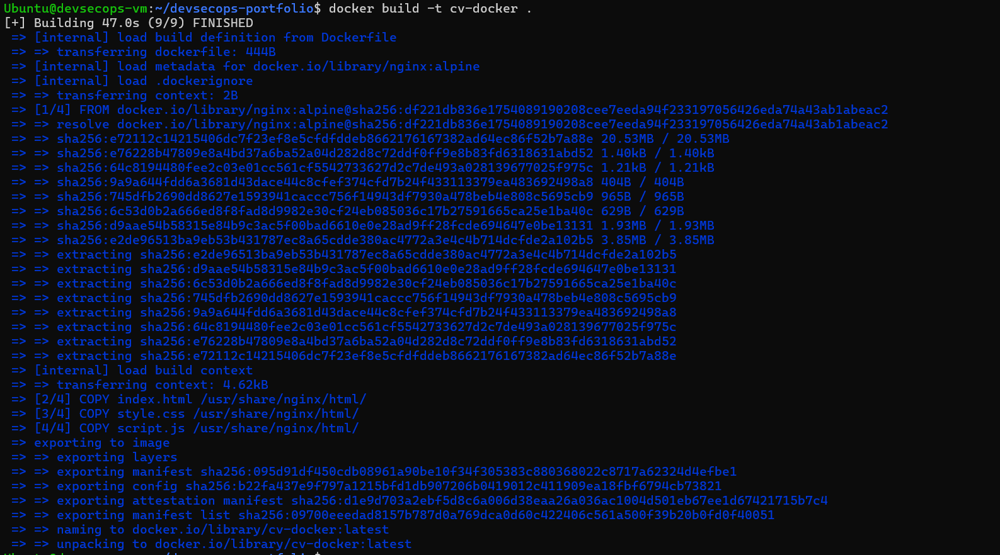

---

### 12. Exécution du conteneur

⚠️ Le port 8080 est déjà occupé par Jenkins, on utilise donc **8082**.

**Commande :**
```bash
docker run -d -p 8082:80 --name cv-container cv-docker
```

**Vérification :**
```bash
docker ps
```
```
CONTAINER ID   IMAGE       PORTS                    NAMES
8e287937f3ce   cv-docker   0.0.0.0:8082->80/tcp     cv-container
```

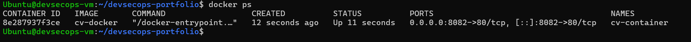

**Accès depuis la machine physique :** 👉 http://192.168.56.101:8082

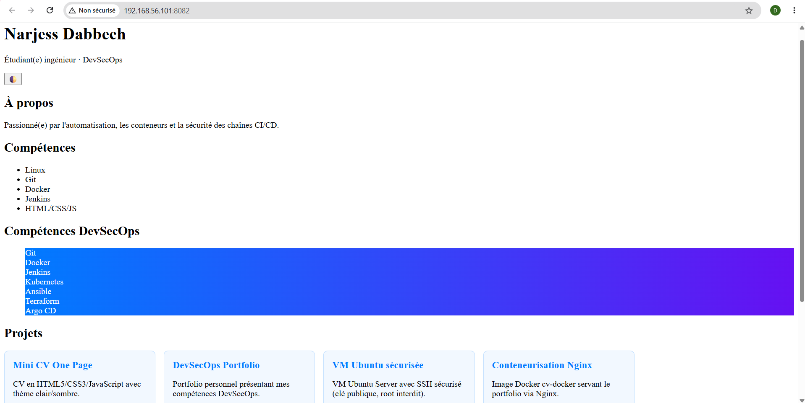

---

### 13. Déploiement avec Docker Compose

**Fichier `docker-compose.yml` :**
```yaml
services:
  portfolio:
    build: .
    image: cv-docker
    container_name: cv-compose
    ports:
      - "8083:80"
    restart: unless-stopped
```

**Commande :**
```bash
docker compose up -d
```

**Vérification :**
```bash
docker compose ps
```
```
NAME         IMAGE       STATUS         PORTS
cv-compose   cv-docker   Up X seconds   0.0.0.0:8083->80/tcp
```

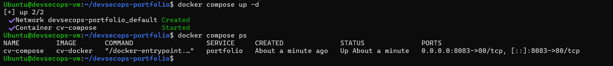

**Accès :** 👉 http://192.168.56.101:8083

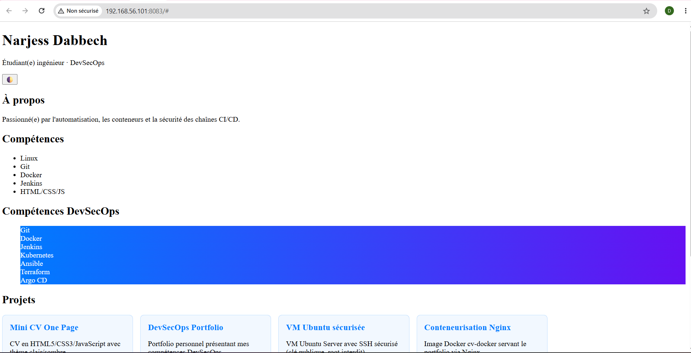

---

### 14. Publication sur GitHub

**Commandes Git :**
```bash
git add .
git commit -m "Activité 10-14: Dockerisation du portfolio"
git push
```

**Lien du dépôt :** https://github.com/Narjess805/minicv

---

## IV. Première introduction à l'automatisation

### 15. Installation de Vagrant

**Installation via le dépôt officiel HashiCorp :**
```bash
wget -O- https://apt.releases.hashicorp.com/gpg | \
  sudo gpg --dearmor -o /usr/share/keyrings/hashicorp-archive-keyring.gpg

echo "deb [signed-by=/usr/share/keyrings/hashicorp-archive-keyring.gpg] \
  https://apt.releases.hashicorp.com $(lsb_release -cs) main" | \
  sudo tee /etc/apt/sources.list.d/hashicorp.list

sudo apt update
sudo apt install -y vagrant
```

**Vérification :**
```bash
vagrant --version
```
```
Vagrant 2.4.9
```

**Installation complémentaire libvirt/QEMU :**
```bash
sudo apt install -y qemu-kvm libvirt-daemon-system libvirt-clients \
  bridge-utils vagrant-libvirt
sudo systemctl status libvirtd
```

**Vagrantfile créé :**
```ruby
Vagrant.configure("2") do |config|
  config.vm.box = "generic/ubuntu2204"
  config.vm.hostname = "vagrant-vm"
  config.vm.network "private_network", ip: "192.168.121.200"

  config.vm.provider "libvirt" do |lv|
    lv.memory = 1024
    lv.cpus = 1
  end
end
```

### ⚠️ Limitation d'environnement

La VM `devsecops-vm` tourne **elle-même dans un environnement virtualisé KVM** :

```bash
sudo dmesg | grep -i "Hypervisor detected"
# [0.000000] Hypervisor detected: KVM
# [0.080963] Booting paravirtualized kernel on KVM
```

**Le nested KVM n'est pas exposé à cette VM**, ce qui rend impossible la création d'une VM enfant :

| Test | Résultat |
|---|---|
| `ls /dev/kvm` | `No such file or directory` |
| `grep -E "vmx\|svm" /proc/cpuinfo` | Aucun résultat |
| `sudo modprobe kvm_intel` | Échec (nested non exposé) |
| `vagrant plugin list` | `No plugins installed` |
| `vagrant up` | `No usable default provider could be found` |

**Tentative d'exécution :**
```bash
vagrant up
```
```
The provider 'libvirt' could not be found, but was requested to
back the machine 'default'. Please use a provider that exists.
```

### 16. Connexion via `vagrant ssh` (documentation théorique)

Sur un setup supportant la virtualisation imbriquée, la connexion se ferait ainsi :
```bash
vagrant up
vagrant ssh
```
```
Welcome to Ubuntu 22.04.5 LTS (GNU/Linux 5.15.0-...)
vagrant@vagrant-vm:~$
```

**Comparaison création Vagrant vs création manuelle :**

| Critère | Vagrant | Création manuelle |
|---|---|---|
| Temps de setup | 1 commande (`vagrant up`) | Étapes GUI multiples |
| Reproductibilité | ✅ Totale (Vagrantfile versionné) | ❌ Manuelle |
| Gestion multi-VM | ✅ Native | ❌ Manuelle |
| Provisioning | ✅ Automatique (shell, Ansible) | ❌ Manuel |
| Portabilité | ✅ Multi-provider | ❌ Dépend de la plateforme |

### 17. Vagrantfile configuré

**Paramètres configurés :**
- **Nom de la VM** : `vagrant-vm` (`config.vm.hostname`)
- **Adresse IP privée** : `192.168.121.200`
- **Mémoire** : `1024 Mo` (`lv.memory`)
- **CPUs** : `1` (`lv.cpus`)

**Résultat attendu de `vagrant status` :**
```
Current machine states:

default                   not created (libvirt)
```
